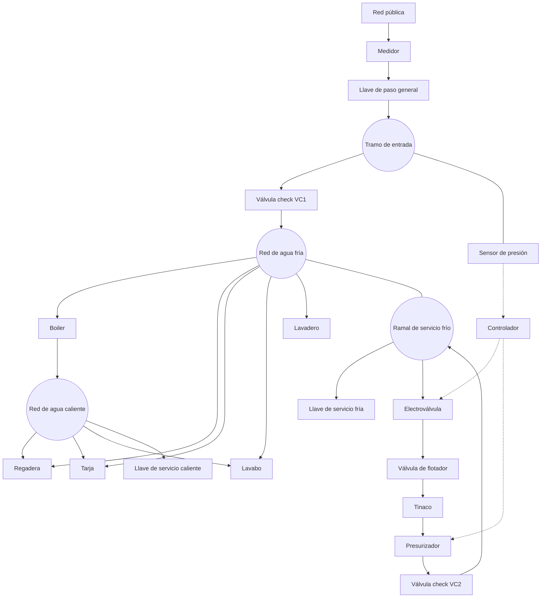

# WaterSystem San Sebastián


## Descripción

WaterSystem San Sebastián es un proyecto de código abierto para la automatización de instalaciones hidráulicas domésticas, diseñado para mitigar los efectos de las interrupciones y variaciones de presión en el suministro público de agua.

El sistema integra un depósito de almacenamiento (tinaco), un presurizador, válvulas antirretorno, una electroválvula y un sistema de control electrónico basado en microcontroladores de bajo costo.

Su diseño busca aprovechar la infraestructura hidráulica existente, reduciendo los costos de implementación y evitando modificaciones innecesarias en las instalaciones domésticas.

## Objetivos

- Garantizar la continuidad del suministro doméstico mientras exista agua almacenada y energía eléctrica.
- Dar prioridad al suministro procedente de la red pública.
- Automatizar el almacenamiento de agua.
- Conmutar automáticamente entre las fuentes de suministro.
- Evitar la recirculación de agua durante la presurización.
- Prevenir el retorno de agua hacia la red pública.
- Reducir el consumo eléctrico innecesario.
- Mantener la operación convencional de la instalación ante fallos electrónicos.
- Proporcionar una solución accesible, reproducible y modificable.

## Principios de diseño

- Bajo costo de implementación.
- Independencia de servicios en la nube.
- Operación autónoma.
- Modularidad.
- Mantenimiento sencillo.
- Seguridad hidráulica y eléctrica.
- Compatibilidad con instalaciones existentes.
- Uso de componentes comercialmente accesibles.
- Documentación abierta.

## Arquitectura del sistema

El proyecto está compuesto por tres subsistemas.

### Sistema hidráulico

Comprende la instalación doméstica existente y los componentes adicionales necesarios para almacenar y distribuir agua.

- Medidor de agua.
- Llave de paso general.
- Válvulas antirretorno.
- Tinaco.
- Válvula de flotador.
- Electroválvula.
- Presurizador.
- Red de distribución de agua fría.
- Red de distribución de agua caliente.

### Sistema electrónico

Responsable de adquirir información sobre el estado hidráulico y controlar los actuadores.

- Microcontrolador ESP32 o Arduino UNO.
- Sensor de presión.
- Etapas de potencia.
- Fuente de alimentación.
- Sensores auxiliares de seguridad.
- Protecciones eléctricas.

### Sistema de control

Firmware desarrollado en C++ utilizando el framework Arduino.

La lógica se implementa mediante una máquina de estados finitos que administra las transiciones entre el suministro público y el suministro auxiliar.

## Funcionamiento

| Condición | Electroválvula | Presurizador |
|---|---|---|
| Presión pública suficiente | Abierta | Inhibido |
| Interrupción del suministro | Cerrada | Habilitado |
| Suministro auxiliar sin consumo | Cerrada | En espera |
| Suministro auxiliar con consumo | Cerrada | Encendido |
| Restablecimiento del suministro | Abierta | Inhibido |
| Fallo electrónico detectado | Cerrada | Inhibido |
| Interrupción eléctrica | Cerrada | Apagado |

El presurizador deberá contar con un mecanismo de activación por demanda o un sistema de control equivalente.

## Diagrama funcional



## Plataformas compatibles

| Plataforma | Soporte previsto |
|---|---|
| ESP32 | Sí |
| Arduino UNO R3 | Sí |
| Arduino Nano ATmega328P | Posible adaptación |
| Otros microcontroladores | Pendiente de evaluación |

El proyecto no requiere conectividad a Internet para su funcionamiento básico.

La implementación para ESP32 permite futuras extensiones de monitoreo remoto, telemetría e integración con sistemas de domótica.

## Lista básica de materiales

| Componente | Cantidad |
|---|---:|
| ESP32 o Arduino UNO | 1 |
| Sensor de presión | 1 |
| Tinaco | 1 |
| Presurizador | 1 |
| Válvula check | 2 |
| Electroválvula normalmente cerrada | 1 |
| Válvula de flotador | 1 |
| Etapa de potencia para electroválvula | 1 |
| Relevador o contactor para presurizador | 1 |
| Fuente de alimentación | 1 |
| Gabinete de protección | 1 |
| Protecciones eléctricas | Según dimensionamiento |
| Tuberías y conexiones hidráulicas | Según instalación |
| Sensor de nivel mínimo | 1, recomendado |
| Sensor de confirmación de cierre | 1, recomendado |

Las especificaciones definitivas deberán determinarse de acuerdo con las características de cada instalación.

## Características del firmware

- Máquina de estados finitos.
- Histéresis de presión.
- Temporizadores configurables.
- Operación no bloqueante.
- Interbloqueo de actuadores.
- Detección de lecturas anómalas.
- Registro de eventos mediante puerto serial.
- Estado seguro durante la inicialización.
- Enclavamiento de fallos detectados.
- Soporte para sensores auxiliares de seguridad.

## Compilación

El firmware puede compilarse utilizando Arduino IDE o herramientas compatibles con el framework Arduino.

1. Clonar el repositorio:

```bash
git clone https://github.com/paynalton/watersystem-sansebas.git
cd watersystem-sansebas
```

2. Seleccionar el código correspondiente al microcontrolador.
3. Configurar la tarjeta en el entorno de desarrollo.
4. Ajustar la asignación de pines.
5. Configurar los parámetros del sensor de presión.
6. Compilar y cargar el firmware.
7. Realizar pruebas de funcionamiento antes de conectar los actuadores definitivos.

## Estado del proyecto

**Fase experimental y de desarrollo.**

El proyecto todavía requiere validación hidráulica, electrónica y operativa en condiciones reales.

- [x] Definición de objetivos.
- [x] Diseño de la arquitectura hidráulica.
- [x] Diseño de la arquitectura electrónica.
- [x] Modelado de la máquina de estados.
- [x] Desarrollo inicial del firmware para ESP32.
- [x] Desarrollo inicial del firmware para Arduino UNO.
- [x] Elaboración de documentación técnica.
- [x] Elaboración de lista preliminar de materiales.
- [ ] Selección definitiva de componentes.
- [ ] Dimensionamiento hidráulico.
- [ ] Compilación y pruebas del firmware.
- [ ] Construcción del prototipo electrónico.
- [ ] Pruebas de seguridad.
- [ ] Instalación del sistema.
- [ ] Validación en condiciones reales.
- [ ] Publicación de una versión estable.

## Seguridad y limitaciones

Este proyecto constituye un diseño experimental y no debe considerarse un sistema certificado para instalaciones hidráulicas o eléctricas.

Antes de su implementación deberán verificarse, entre otros aspectos:

- La protección contra contaminación y reflujo hacia la red pública.
- El cumplimiento de la normativa local aplicable.
- La compatibilidad de los materiales con agua potable.
- La presión máxima admisible de la instalación.
- La protección contra funcionamiento en seco del presurizador.
- La detección de presión residual en la entrada.
- El comportamiento ante fallos de sensores y actuadores.
- El aislamiento y dimensionamiento de los componentes eléctricos.
- El comportamiento ante interrupciones eléctricas.
- La efectividad de los mecanismos de interbloqueo.

El firmware no sustituye las protecciones físicas, hidráulicas y eléctricas necesarias.

## Documentación

La documentación técnica del proyecto comprende:

- Memoria técnica.
- Diagramas hidráulicos.
- Diagramas UML.
- Arquitectura electrónica.
- Máquinas de estados.
- Lista de materiales.
- Análisis de riesgos.
- Plan de implementación y validación.

El modelo UML constituye la referencia para mantener la coherencia del diseño.

## Contribuciones

Las contribuciones de la comunidad son bienvenidas.

Se pueden realizar aportaciones relacionadas con:

- Mejoras del firmware.
- Seguridad hidráulica y eléctrica.
- Optimización de costos.
- Compatibilidad con otros microcontroladores.
- Diseño de circuitos electrónicos.
- Documentación.
- Simulaciones y pruebas.
- Monitoreo e integración con domótica.
- Adaptación a diferentes instalaciones domésticas.

Para reportar errores, proponer mejoras o discutir modificaciones de diseño, pueden utilizarse los Issues del repositorio.

Las propuestas de modificación pueden presentarse mediante Pull Requests.

## Licencia

Este proyecto se distribuye bajo los términos de la **GNU General Public License, versión 3 (GPLv3)**.

Se permite utilizar, estudiar, modificar y redistribuir el software, siempre que se respeten las condiciones establecidas por la licencia.

Las redistribuciones del software cubierto, incluidas sus versiones modificadas, deberán cumplir las obligaciones correspondientes de disponibilidad del código fuente y conservación de la licencia.

El software se proporciona sin garantía, en los términos establecidos por la GPLv3.

Para más información, consultar el archivo [LICENSE](LICENSE) o el texto oficial de la licencia:

https://www.gnu.org/licenses/gpl-3.0.html

## Autor

**Paynalton**

- Sitio web: https://paynalton.tech
- GitHub: https://github.com/paynalton
- Repositorio: https://github.com/paynalton/watersystem-sansebas

---

*Tecnología abierta para resolver problemas cotidianos mediante soluciones accesibles, autónomas y reproducibles.*
