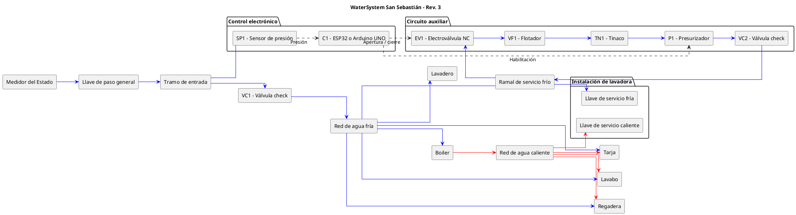
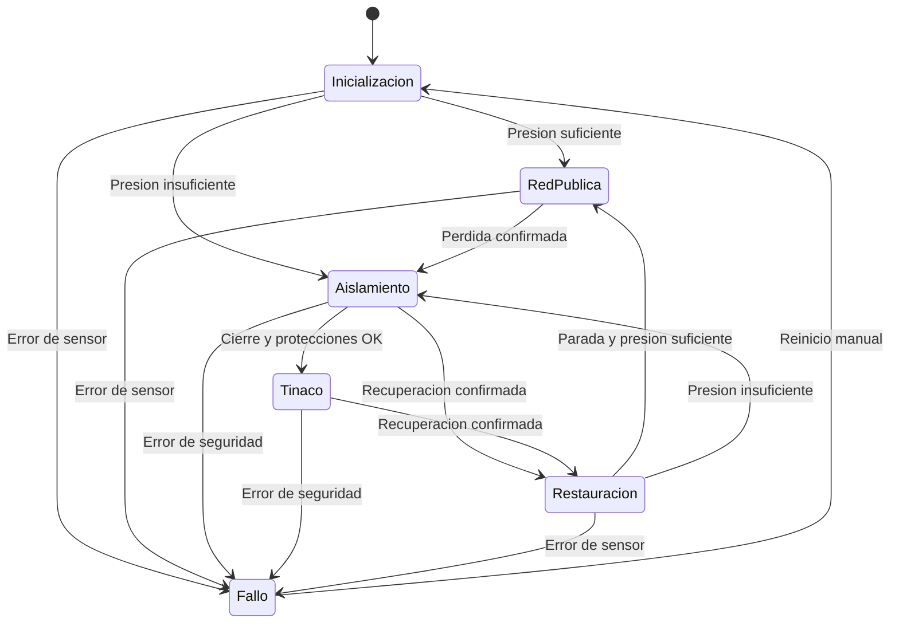

# WaterSystem San Sebastián

**Memoria técnica del proyecto hidráulico doméstico**  
**Revisión del diseño:** 3  
**Fecha:** 25 de noviembre de 2026  
**Estado:** Diseño conceptual y prototipo de firmware; pendiente de validación física.

## 1. Descripción del proyecto

WaterSystem San Sebastián es un proyecto de adecuación de una instalación hidráulica doméstica para mantener el suministro de agua durante interrupciones o periodos de presión insuficiente de la red pública. Se propone incorporar un tinaco, un presurizador y un sistema de control electrónico de bajo costo, conservando la distribución hidráulica existente.

La instalación dará prioridad al suministro público cuando su presión sea suficiente y utilizará el agua almacenada como respaldo cuando sea necesario. El control será autónomo y no dependerá de Internet ni de servicios externos.

El repositorio público del proyecto es [paynalton/watersystem-sansebas](https://github.com/paynalton/watersystem-sansebas) [1].

## 2. Objetivos

- Mantener el suministro doméstico durante interrupciones de la red pública, mientras exista agua almacenada y energía para la operación auxiliar.
- Conservar las conexiones actuales de agua fría y caliente.
- Automatizar la selección de la fuente de suministro.
- Evitar el retorno de agua hacia la red pública y la recirculación hacia el tinaco durante la presurización.
- Mantener operativo el suministro directo de la red pública ante fallos de la electrónica.
- Utilizar componentes económicos, reemplazables y de fácil mantenimiento.
- Mantener el diseño y el firmware documentados y versionados.

## 3. Instalación hidráulica original

El agua de la red pública entra por un medidor proporcionado por el Estado y atraviesa una llave de paso general. A continuación, la tubería se distribuye a los servicios domésticos y al boiler. El boiler alimenta la red de agua caliente.

| Servicio | Agua fría | Agua caliente |
|---|:---:|:---:|
| Boiler | Entrada | Salida |
| Regadera | Sí | Sí |
| Tarja | Sí | Sí |
| Lavabo | Sí | Sí |
| Lavadero | Sí | No |
| Llave de servicio fría (lavadora) | Sí | No |
| Llave de servicio caliente (lavadora) | No | Sí |

Las dos llaves de servicio corresponden a la instalación de la lavadora y permanecen hidráulicamente independientes.

## 4. Modificaciones propuestas

Después de la llave de paso general se instala una válvula antirretorno (VC1). Entre ambos elementos se incorpora una derivación para medir la presión de entrada mediante SP1.

Desde el ramal de agua fría que alimenta la llave de servicio de la lavadora se deriva una tubería hacia el tinaco. Esta tubería incluye una electroválvula normalmente cerrada (EV1) y termina en una válvula de flotador (VF1), encargada de limitar el llenado.

La salida del tinaco se conecta al presurizador (P1), seguido de una segunda válvula antirretorno (VC2). La descarga vuelve al mismo ramal de servicio frío, desde donde puede alimentar toda la red doméstica, incluido el boiler.

| Identificador | Componente | Función |
|---|---|---|
| VC1 | Válvula check | Impedir el flujo inverso hacia la alimentación pública. |
| SP1 | Sensor de presión | Medir la presión aguas arriba de VC1 y después de la llave general. |
| EV1 | Electroválvula normalmente cerrada | Autorizar el llenado y aislar la entrada del tinaco durante el suministro auxiliar. |
| VF1 | Válvula de flotador | Detener el llenado cuando se alcanza el nivel máximo. |
| TN1 | Tinaco | Almacenar agua para contingencias. |
| P1 | Presurizador | Alimentar la red doméstica desde el tinaco. |
| VC2 | Válvula check | Impedir el flujo inverso hacia el presurizador. |
| C1 | Microcontrolador | Coordinar la conmutación y los interbloqueos. |
| SN1 | Sensor de nivel mínimo (propuesto) | Evitar funcionamiento en seco. |
| SF1 | Confirmación de cierre (propuesta) | Verificar el cierre físico de EV1. |

## 5. Diagrama funcional

El siguiente modelo PlantUML representa la topología de la revisión 3. Las líneas azules indican agua fría, las rojas agua caliente y las discontinuas señales de control. No representa dimensiones, ubicación física ni diámetros de tubería.

## 6. Operación hidráulica y electrónica

### 6.1. Suministro público disponible

Cuando SP1 detecta presión suficiente y estable, C1 inhibe P1 y abre EV1. El suministro público alimenta directamente los servicios y permite llenar el tinaco hasta que VF1 cierre mecánicamente. VC2 evita el retorno de agua hacia P1.

### 6.2. Interrupción o presión insuficiente

Cuando la presión de entrada permanece por debajo del umbral configurado, C1 ordena cerrar EV1. Tras la espera de cierre y, si existe SF1, la confirmación física, el controlador habilita P1. El presurizador debe disponer de su propio mecanismo de arranque por demanda. VC1 impide el retorno hacia la red pública; EV1 evita la recirculación hacia el tinaco.

EV1 permanece cerrada durante todo el modo auxiliar, aun cuando P1 se detenga por falta de consumo.

### 6.3. Recuperación del suministro

Cuando SP1 detecta presión suficiente durante el intervalo de recuperación, C1 deshabilita P1, espera su parada y posteriormente abre EV1. El suministro público vuelve a ser prioritario y se reanuda el llenado del tinaco cuando VF1 lo permite.

### 6.4. Fallo eléctrico o electrónico

Con EV1 normalmente cerrada y un contactor de P1 desenergizado por defecto, un apagón desactiva el circuito auxiliar sin interrumpir por sí mismo el paso directo de agua pública. Durante el apagón no se garantiza el suministro desde el tinaco ni su llenado.

## 7. Máquina de estados

| Estado | EV1 | P1 | Transición principal |
|---|---|---|---|
| Inicialización | Cerrada | Inhibido | Clasificar presión estable. |
| Red pública | Abierta | Inhibido | Detectar presión insuficiente. |
| Aislamiento | Cerrada | Inhibido | Esperar cierre y comprobar condiciones de seguridad. |
| Tinaco | Cerrada | Habilitado | Detectar recuperación o fallo. |
| Restauración | Cerrada | Inhibido | Esperar parada y confirmar suministro público. |
| Fallo | Orden de cierre | Inhibido | Reinicio manual después de corregir la causa, en el prototipo. |

**Invariante de control:** nunca ordenar la apertura de EV1 mientras P1 esté habilitado. La orden lógica no constituye confirmación física: se recomienda un interbloqueo independiente y realimentación de los actuadores.

## 8. Implementación del controlador

Se contemplan dos alternativas: ESP32 DevKit clásico y Arduino UNO R3 (ATmega328P). Ambas son suficientes para ejecutar la máquina de estados mediante C++ y el framework Arduino. El ESP32 facilita una futura integración con domótica; el UNO permite una implementación autónoma sin conectividad integrada. No se ha establecido una plataforma definitiva.

| Señal | ESP32 | Arduino UNO R3 |
|---|---|---|
| SP1: presión analógica | GPIO 34 | A0 |
| EV1: orden de apertura | GPIO 25 | D7 |
| P1: habilitación | GPIO 26 | D8 |
| SN1: nivel mínimo (opcional en prototipo) | GPIO 27 | D2 |
| SF1: confirmación de cierre (opcional en prototipo) | GPIO 32 | D3 |

El firmware propuesto utiliza `millis()` para temporización no bloqueante, histéresis, validación del rango eléctrico del sensor, interbloqueo lógico y telemetría serial. Los fallos detectados se enclavan hasta el reinicio en las versiones iniciales.

Para un sensor analógico de ejemplo de 0–6 bar con salida de 0.5–4.5 V, el ESP32 requiere acondicionamiento de señal compatible con su ADC de 3.3 V; el UNO puede utilizar la señal directamente si la referencia y alimentación son compatibles. Deben verificarse el rango útil real del ADC, la calibración y la detección de desconexión.

### 8.1. Parámetros provisionales

| Parámetro | Valor inicial |
|---|---:|
| Umbral de pérdida de presión | 0.5 bar |
| Umbral de recuperación | 1.0 bar |
| Confirmación de pérdida | 5 s |
| Confirmación de recuperación | 10 s |
| Espera mínima de cierre de EV1 | 3 s |
| Tiempo máximo de confirmación de cierre | 10 s |
| Espera después de deshabilitar P1 | 3 s |
| Intervalo de lectura de presión | 100 ms |
| Intervalo de telemetría serial | 5 s |

Estos valores provienen de los prototipos de firmware elaborados durante el diseño y no son especificaciones hidráulicas definitivas. Se deberán ajustar mediante mediciones y pruebas reales.

### 8.2. Etapas de potencia

Las salidas del microcontrolador no deben alimentar directamente los actuadores. Se requiere una etapa de potencia adecuada para EV1, un relevador o contactor dimensionado para la corriente de arranque de P1, protección contra transitorios inductivos y una fuente de alimentación compatible. Las salidas deben quedar desactivadas por hardware durante el arranque, reinicio o pérdida de alimentación del controlador.

## 9. Lista de materiales (BOM)

Lista preliminar para adaptar la instalación existente. Las cantidades corresponden al diseño funcional; no incluyen la sustitución de los servicios ya instalados. Los diámetros, capacidades, potencias y longitudes deberán definirse tras el levantamiento físico. Los componentes en contacto con agua deben ser aptos para agua potable.

### 9.1. Componentes hidráulicos

| ID | Material | Cantidad | Especificación o criterio de selección |
|---|---|---:|---|
| VC1 | Válvula check de entrada | 1 | Diámetro y presión compatibles con la acometida; verificar requisitos de protección sanitaria contra reflujo. |
| VC2 | Válvula check de descarga | 1 | Compatible con el caudal y presión máxima de P1. |
| SP1 | Transductor de presión | 1 | Rango provisional 0–6 bar, salida 0.5–4.5 V, alimentación 5 V; conexión hidráulica compatible. |
| EV1 | Electroválvula normalmente cerrada | 1 | 12 o 24 V CC, servicio continuo, apta para agua potable; debe cerrar sin energía y operar con la presión diferencial disponible. |
| VF1 | Válvula de flotador | 1 | Compatible con el tinaco y caudal de llenado. |
| TN1 | Tinaco con tapa | 1 | Capacidad por definir según consumo y autonomía; instalación y soporte adecuados a su peso lleno. |
| P1 | Presurizador automático por demanda | 1 | Caudal, altura, presión y alimentación por definir; protección contra trabajo en seco o protección externa. |
| — | Conexión en T para SP1 | 1 | Con adaptador al puerto del sensor. |
| — | Conexiones en T para llenado y retorno | 2 | Una por cada unión al ramal frío, o colector equivalente. |
| — | Tubería, codos, coples, reducciones y adaptadores | Según medición | Compatibles con el material existente y la presión máxima de trabajo. |
| — | Uniones desmontables y válvulas manuales de aislamiento | Según montaje | Recomendadas para mantenimiento de tinaco, bomba y electroválvula. |
| — | Conexiones de ventilación, rebosadero y drenaje del tinaco | 1 juego | Según fabricante y condiciones sanitarias de instalación. |
| — | Sellos, cinta PTFE o sellador compatible, abrazaderas y soportes | Según montaje | Adecuados al tipo de unión y tubería. |

### 9.2. Componentes electrónicos y eléctricos

| ID | Material | Cantidad | Especificación o criterio de selección |
|---|---|---:|---|
| C1 | ESP32 DevKit **o** Arduino UNO R3 | 1 | Alternativas excluyentes; no es necesario adquirir ambos. |
| — | Fuente de alimentación CC | 1 o más | Dimensionada para EV1, controlador y circuitos auxiliares; salida regulada compatible con la placa. |
| — | Etapa de potencia para EV1 | 1 | MOSFET o relevador compatible con tensión y corriente de la válvula; protección inductiva. |
| — | Relevador o contactor para P1 | 1 | Dimensionado para carga de motor y corriente de arranque; interfaz de habilitación compatible con el presurizador. |
| — | Etapa de interfaz del contactor | 1 si se requiere | Adaptación de señal, aislamiento y protección de bobina según el equipo elegido. |
| — | Resistencias de acondicionamiento de SP1 | 1 juego si se requiere | Para ESP32, divisor o acondicionamiento compatible con el ADC; valores finales tras calibración. |
| — | Resistencias de estado seguro y detección de desconexión | 1 juego | Salidas desactivadas durante arranque y entradas con estado definido. |
| — | Gabinete eléctrico, borneras, prensaestopas y cableado | 1 juego | Protección contra humedad, separación de potencia y baja tensión. |
| — | Protecciones eléctricas y puesta a tierra | Según instalación | Protección contra sobrecorriente, fallas a tierra y transitorios, dimensionadas por personal calificado. |

### 9.3. Protecciones adicionales y materiales de prueba

| Material | Cantidad orientativa | Condición |
|---|---:|---|
| SN1: sensor de nivel mínimo | 1 | Necesario si P1 no incorpora protección efectiva contra funcionamiento en seco. |
| SF1: sensor de confirmación de cierre de EV1 | 1 | Recomendado para verificar aislamiento físico antes de habilitar P1; seleccionar una válvula que permita esta comprobación. |
| Interbloqueo eléctrico independiente | 1 juego | Recomendado para impedir habilitación simultánea de llenado y bombeo ante fallos del controlador. |
| Dispositivo certificado de protección contra reflujo | Según evaluación | Si las disposiciones aplicables o la evaluación sanitaria lo requieren; una check simple no garantiza protección suficiente. |
| Manómetro de prueba | 1 | Para calibración de SP1 y comprobación de presiones reales. |
| Protección contra sobrepresión o golpe de ariete | Según evaluación | Determinar necesidad y tipo mediante pruebas y dimensionamiento. |
| Multímetro, cargas de prueba y material de prototipado | 1 juego | Para validar el firmware y las etapas de potencia antes de conectar actuadores reales. |

La lista no constituye todavía una orden de compra. Quedan pendientes el inventario de materiales reutilizables, la selección definitiva del controlador, el dimensionamiento hidráulico y eléctrico, los modelos comerciales y el presupuesto. No se han estimado precios sin estas especificaciones.

## 10. Seguridad y riesgos pendientes

| Riesgo | Medida propuesta o pendiente |
|---|---|
| Reflujo hacia la red pública | Verificar si VC1 es suficiente o se requiere un dispositivo de protección certificado conforme a las disposiciones aplicables. |
| Recirculación hacia TN1 | Cerrar EV1 antes de habilitar P1; verificar cierre físico e interbloqueo independiente. |
| Funcionamiento en seco | Incorporar protección efectiva por nivel mínimo o confirmar que P1 dispone de ella. |
| Presión residual antes de VC1 | Evaluar si SP1 puede detectar una interrupción real cuando la presión queda atrapada en el tramo de entrada. |
| Electroválvula atascada o contactor soldado | Evaluar realimentación de posición y estado del motor, y protección independiente del firmware. |
| Sobrepresión y golpe de ariete | Dimensionar el presurizador y verificar presiones máximas, transitorios y compatibilidad con el boiler. |
| Desconexión o fallo del sensor | Acondicionar la entrada para detectar circuitos abiertos y cortocircuitos; validar fallos con hardware real. |
| Bloqueo o reinicio del microcontrolador | Evaluar watchdog e interbloqueo de hardware con salidas seguras. |
| Contaminación del agua almacenada | Usar componentes aptos para agua potable, tinaco cerrado y ventilación, rebosadero y mantenimiento adecuados; verificar protección sanitaria del llenado. |
| Riesgo eléctrico por humedad | Instalar gabinete, puesta a tierra y protecciones eléctricas apropiadas mediante personal calificado. |
| Fallo enclavado con tinaco vacío | Revisar recuperación segura del llenado cuando regresa la red pública sin requerir intervención innecesaria. |

El diseño no presupone que una sola válvula check constituya protección sanitaria suficiente. Debe revisarse la instalación con un profesional competente antes de conectar el sistema definitivo a la red pública.

## 11. Plan de implementación y validación

| Etapa | Actividad | Criterio de aceptación |
|---|---|---|
| 1 | Levantamiento de la instalación | Topología, materiales, dimensiones y presiones reales identificados. |
| 2 | Selección de componentes | Capacidad, caudal, presión, compatibilidad sanitaria y eléctrica comprobados. |
| 3 | Prototipo electrónico | Compilación del firmware y pruebas de estados con cargas simuladas. |
| 4 | Prueba hidráulica aislada | Llenado, estanqueidad, antirretorno y presurización verificados. |
| 5 | Integración del control | Transiciones, interbloqueos y parada segura comprobados. |
| 6 | Pruebas de contingencia | Cortes eléctricos, fallos de sensores, bajo nivel, presión residual y recuperación evaluados. |
| 7 | Instalación definitiva | Revisión hidráulica y eléctrica, documentación y aceptación de pruebas. |

## 12. Gestión del proyecto y repositorio

El código fuente y la evolución del proyecto se referencian en el repositorio público [1]. Se propone conservar allí los firmwares, modelos PlantUML, documentación técnica, lista de materiales, pruebas y registro de decisiones. También se contempla automatizar la compilación de los firmwares mediante integración continua.

Esta memoria describe el diseño discutido y los prototipos de código generados. No certifica que los archivos del repositorio coincidan actualmente con esos prototipos ni que el firmware haya sido compilado o probado físicamente. La estructura definitiva del repositorio y la selección de hardware permanecen abiertas.

## 13. Referencias

[1] Paynalton. *WaterSystem San Sebastián — repositorio público de código fuente*. GitHub. https://github.com/paynalton/watersystem-sansebas
